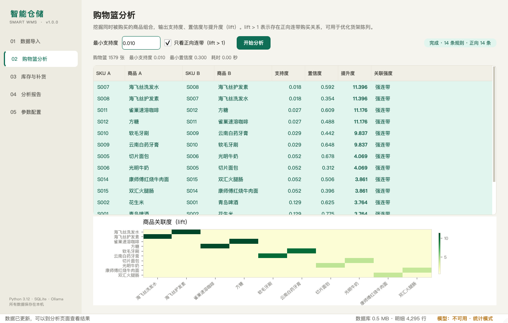
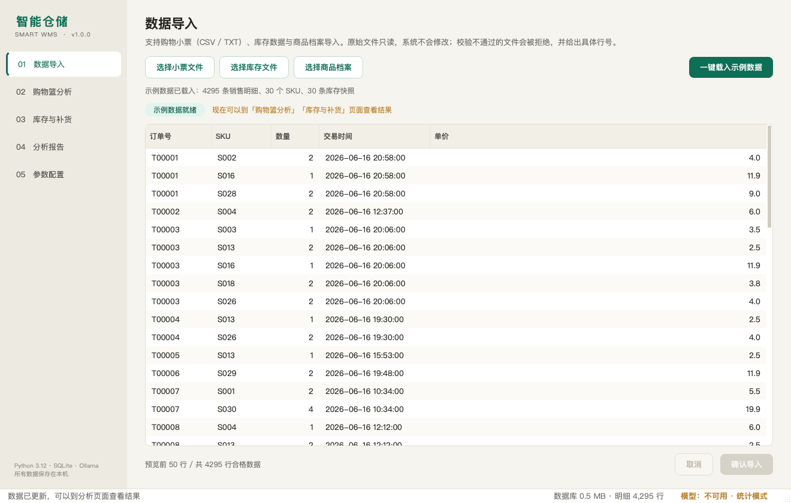
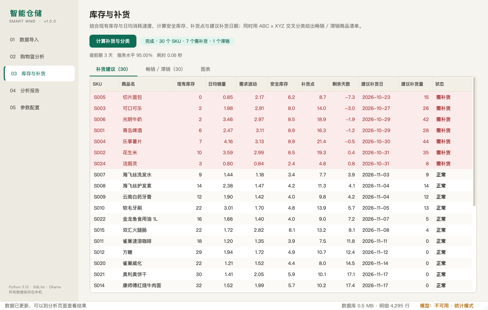
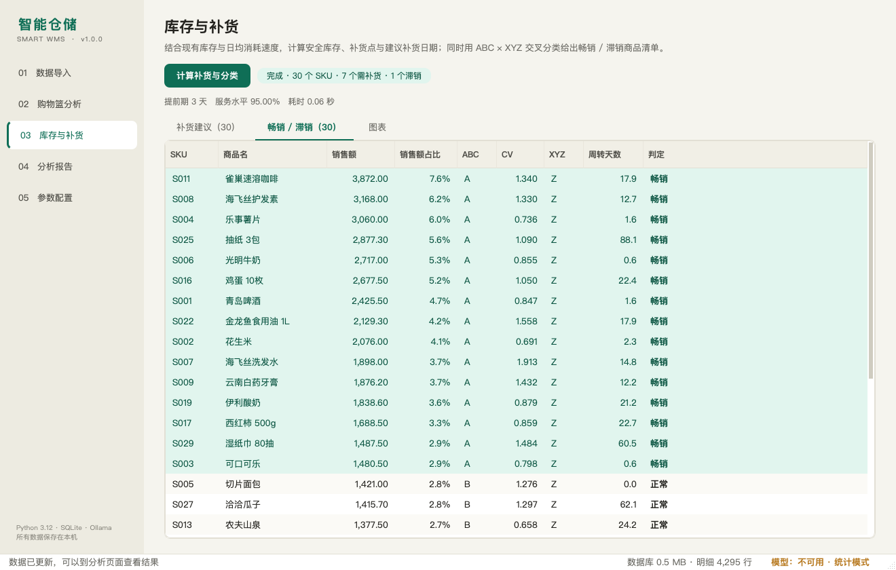
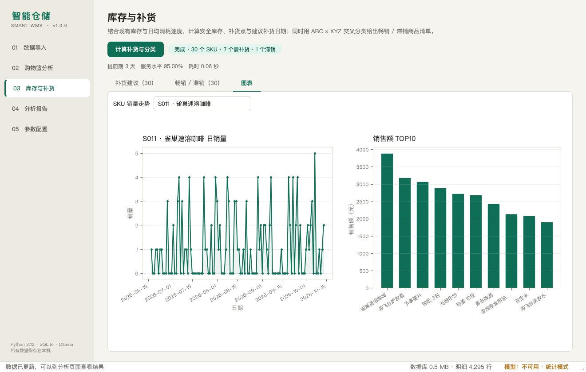
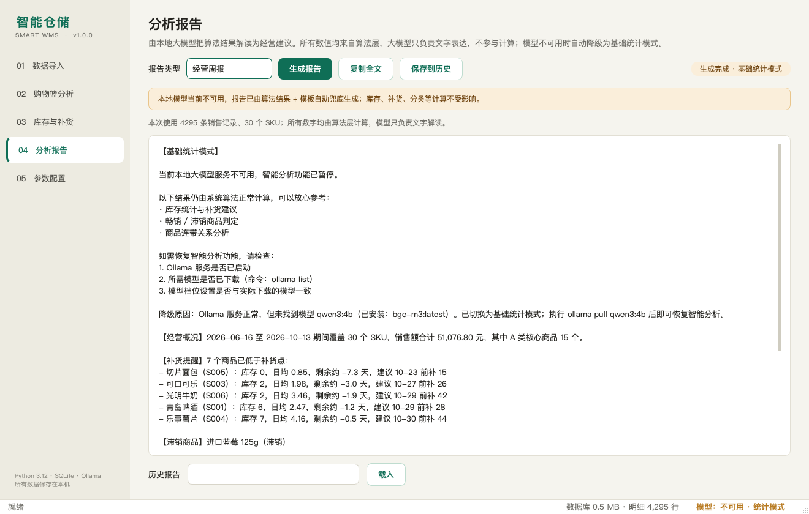
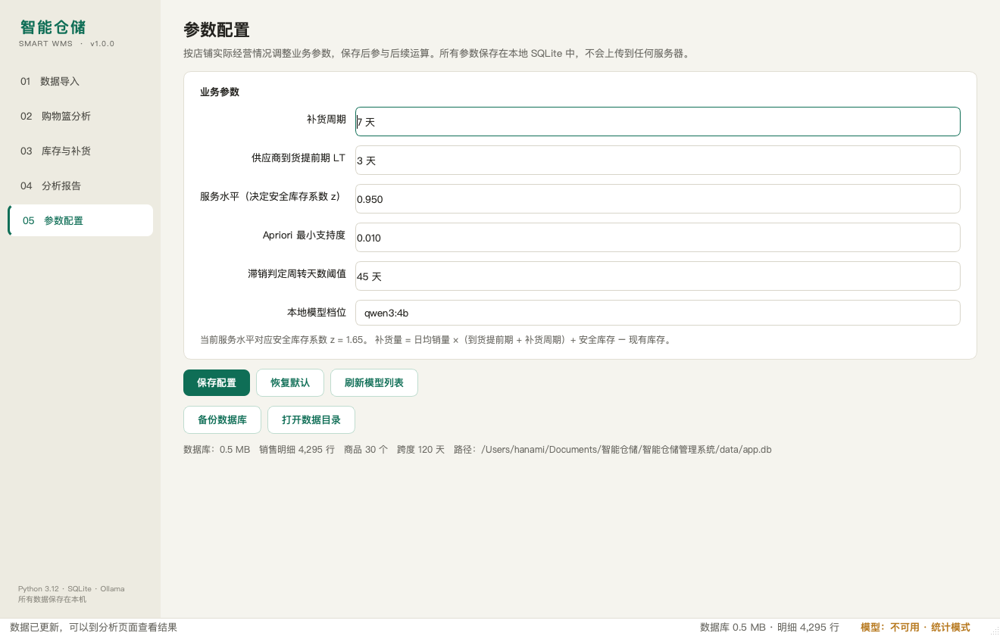
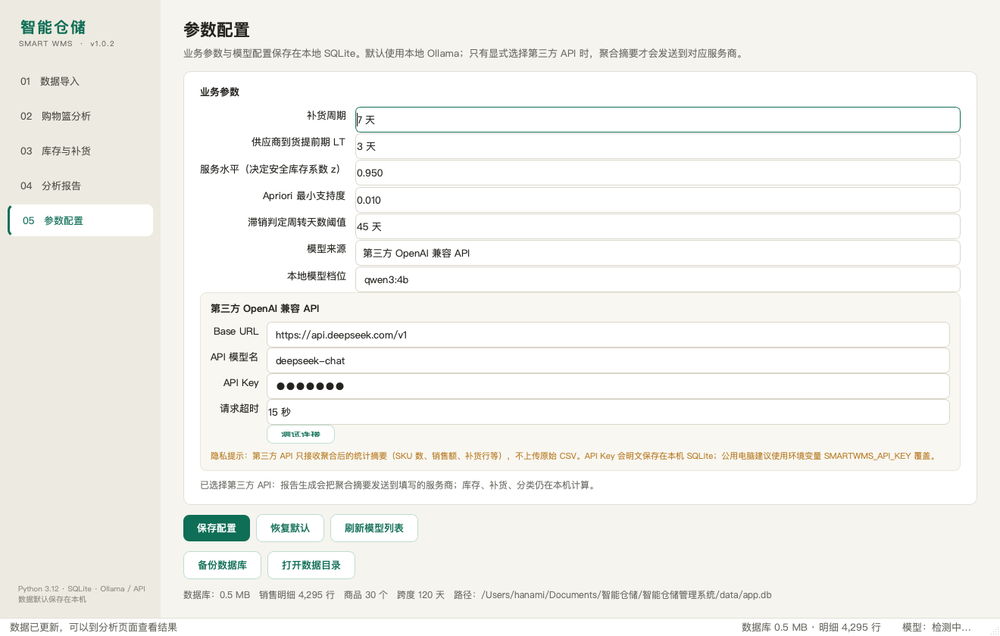
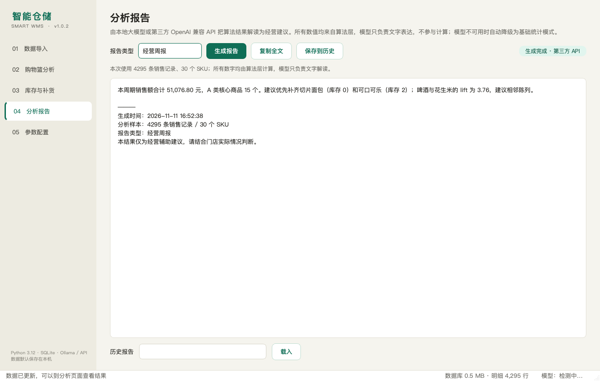

<div align="center">

# 智能仓储管理系统

**把收银小票和库存数据，变成能直接执行的补货、陈列和换季建议**

基于 PySide6 + SQLite + Ollama / OpenAI 兼容 API 的智能仓储桌面应用


[](https://github.com/SBTstudio/Intelligent_Warehousing/actions/workflows/tests.yml)
[](https://github.com/SBTstudio/Intelligent_Warehousing/releases/latest)


[功能](#-功能一览) · [截图](#-界面预览) · [快速开始](#-快速开始) · [算法](#-核心算法) · [文档](#-文档) · [发布说明](docs/RELEASE_v1.0.2.md)

</div>



---

## 直接下载（不需要 Python）

| 平台 | 安装包 | 说明 |
|---|---|---|
| **Windows 10/11 x64** | [SmartWMS-Windows-x64.exe](https://github.com/SBTstudio/Intelligent_Warehousing/releases/latest/download/SmartWMS-Windows-x64.exe) | 免安装单文件，双击运行 |
| **macOS Apple Silicon** | [SmartWMS-macOS-arm64.dmg](https://github.com/SBTstudio/Intelligent_Warehousing/releases/latest/download/SmartWMS-macOS-arm64.dmg) | 打开后拖进 Applications |

> 安装包已内置示例数据，首次打开点「一键载入示例数据」即可。
> Ollama 仍是可选项；不装也能用全部统计、图表、补货功能。
>
> 没有签名，Windows SmartScreen / macOS Gatekeeper 可能提示"未知开发者"，
> 选择「仍要运行」或右键 App → 打开即可。
>
> 其他平台或想改代码，按下面的[源码运行](#-快速开始)方式安装。

---

## 这是什么

面向新零售小店的智能仓储管理软件。它把**收银小票**和**库存快照**放进同一个
SQLite 数据库，用可解释的统计算法算出：

- 哪些商品经常被一起买走（Apriori / lift）；
- 哪些商品该在什么时候补多少（安全库存 / 补货点 / 建议补货日）；
- 哪些是畅销、滞销、呆滞（ABC × XYZ 交叉分类）；
- 哪些品类接下来可能进入旺季（同比 / 环比 / 季节指数）。

默认交给**本机 Ollama** 上的小模型，把数字写成人能看懂的经营建议；
也可以在「参数配置」里切换到**第三方 OpenAI 兼容 API**（DeepSeek、通义千问、OpenAI 等）。
模型只负责表达，不负责计算；模型不可用时自动降级为模板报告，软件不会崩。

> 课程设计项目，但按可交付软件的标准做：有测试、有压测、有异常路径、
> 有用户手册和发布页。默认全部数据留在本机；第三方 API 是显式可选项，
> 只发送聚合摘要，不上传原始 CSV 或数据库。

---

## 功能一览

| 模块 | 能力 | 对应需求 |
|---|---|---|
| **数据导入** | CSV/TXT 编码自动识别、列名同义词、逐行校验、错误带行号、原始文件只读 | 2.2.1 / 2.4.4 |
| **SQLite 数据层** | 6 张表、WAL、覆盖索引、幂等导入、ANALYZE、单文件备份 | 2.5 |
| **购物篮分析** | 手写 Apriori、支持度 / 置信度 / lift、lift 热力图 | 2.1 输入量 1 |
| **补货预测** | 指数平滑、需求波动、安全库存 SS、补货点 ROP、建议补货日/量 | 1.1 目标 1 |
| **畅销滞销** | ABC（销售额贡献）× XYZ（需求稳定性）+ 周转天数 | 2.1 输入量 2 |
| **可视化** | 销量折线图、销售额柱状图、商品关联热力图 | 2.2.2 |
| **LLM 接入** | 默认 Ollama 本地模型；可选 OpenAI 兼容第三方 API；超时/重试/降级 | 2.2.3 / 2.2.4 |
| **分析报告** | 经营周报、滞销归因、陈列建议、换季推荐、热点映射 | 2.2.2 |
| **参数配置** | 6 个业务参数落库、模型档位、数据库备份 | 2.4.3 |
| **历史报告** | 报告保存与下拉回看 | 2.5 |

### 三个不妥协的设计

1. **算法层不碰界面**：`app/core/` 里没有一行 PySide6，可以脱离 GUI 跑测试和压测。
2. **数字不由模型算**：LLM 只拿聚合摘要写文字，避免 4B 模型算错小数。
3. **失败必须可解释**：文件脏、模型没装、服务没启动、JSON 非法，都有明确提示和降级路径。

---

## 界面预览

| 数据导入：校验 + 预览 | 购物篮分析：规则 + 热力图 |
|---|---|
|  |  |

| 库存与补货：紧急行标红 | 畅销 / 滞销：ABC × XYZ |
|---|---|
|  |  |

| 图表：日销量 + 销售额 TOP10 | 分析报告：模型缺失时自动降级 |
|---|---|
|  |  |

| 参数配置：业务参数 + 备份 | 第三方 API：配置与测试连接 |
|---|---|
|  |  |

| 第三方 API 生成报告 |
|---|
|  |

> 截图中的报告页显示"基础统计模式"，是因为截屏机器只装了嵌入模型、
> 没有安装 `qwen3:4b`。装好模型后会自动切换为本地 LLM 输出；
> 也可以在「参数配置」里改用第三方 API。

---

## 快速开始

### 环境要求

- Windows 10/11（主要交付环境）或 macOS / Linux
- Python **3.10+**，推荐 3.12
- 内存 8 GB 可跑统计功能；16 GB 推荐跑 4B 模型
- 可选：Ollama + qwen3:4b（不装也能用，报告自动降级）

### 方式一：Windows 一键安装

```text
1. 安装 Python 3.12（勾选 Add python.exe to PATH）
2. 双击 安装环境.bat
3. 双击 run.bat
4. 在「数据导入」页点击「一键载入示例数据」
```

### 方式二：命令行

```bash
git clone https://github.com/SBTstudio/Intelligent_Warehousing.git
cd Intelligent_Warehousing

python -m venv .venv
# Windows
.venv\Scripts\python.exe -m pip install -r requirements.txt
# macOS / Linux
source .venv/bin/activate && pip install -r requirements.txt

python main.py
```

macOS / Linux 也可以直接：

```bash
chmod +x run.sh
./run.sh
```

### 安装本地模型（可选）

```bash
# 1. 安装 Ollama：https://ollama.com
# 2. 拉取模型（8GB 内存可换 qwen3:1.7b）
ollama pull qwen3:4b
ollama list

# 3. 保持 Ollama 运行，再启动软件
```

启动后状态栏会显示模型状态。模型不可用时，报告页显示琥珀色横幅，
但补货、分类、图表、历史报告全部正常。

---

## 使用流程

```text
数据导入 ──► 购物篮分析 ──► 库存与补货 ──► 分析报告 ──► 参数配置
   │              │                │              │
   │              │                │              └─ 五类报告 / 历史回看
   │              │                └─ 补货表 / 分类表 / 图表
   │              └─ 规则表 + lift 热力图
   └─ 校验 → 入库 → 通知其他页面刷新
```

1. **导入**：选文件或点「一键载入示例数据」；校验不通过会列出具体行号，禁止入库。
2. **购物篮**：调最小支持度，勾选"只看正向连带"，点「开始分析」。
3. **补货**：点「计算补货与分类」，红色行是已低于补货点的 SKU。
4. **报告**：选报告类型 → 生成 → 复制 / 保存到历史。
5. **配置**：改补货周期、提前期、服务水平、滞销阈值、模型档位，保存后重算。

---

## 核心算法

### Apriori 购物篮分析

```
support(A→B)    = |A∩B| / N
confidence(A→B) = support(A∪B) / support(A)
lift(A→B)       = confidence(A→B) / support(B)
                = P(A∩B) / (P(A)·P(B))
```

- 手写实现，没有用 `mlxtend`；可以自己控制支持度口径和 lift 输出格式。
- 候选集用 Apriori 性质剪枝；计数用"枚举篮子内 k 元子集"而不是
  "每个候选扫全表"，三年数据仍能在秒级完成。
- 示例数据里**故意埋了 7 组连带关系**，算法实际挖出 14 条规则（每组双向），
  前 3 组 lift 均大于 11：

| 规则 | 支持度 | 置信度 | lift |
|---|---:|---:|---:|
| 海飞丝洗发水 → 海飞丝护发素 | 0.018 | 0.592 | **11.396** |
| 雀巢速溶咖啡 → 方糖 | 0.027 | 0.609 | **11.176** |
| 软毛牙刷 → 云南白药牙膏 | 0.029 | 0.442 | **9.837** |
| 切片面包 → 光明牛奶 | 0.052 | 0.678 | **4.069** |
| 康师傅红烧牛肉面 → 双汇火腿肠 | 0.052 | 0.506 | **3.861** |

### 补货预测

```
d̄    = 指数平滑(日销量, α=0.3)
σ_d  = 日销量标准差
z    = 服务水平对应的正态分位（95% → 1.65）
SS   = z · σ_d · √LT
ROP  = d̄ · LT + SS
剩余天数 = (库存 − SS) / d̄
建议补货日 = 今天 + 剩余天数 − LT
建议补货量 = d̄ · (LT + 补货周期) + SS − 库存
```

### ABC × XYZ 分类

```
ABC：按销售额降序累计，≤70% A，≤90% B，其余 C
XYZ：CV = σ/μ，<0.2 X，0.2~0.5 Y，≥0.5 Z
滞销：C 类 + Z 类 + 周转天数 > 阈值
呆滞：C 类 + 周转天数 > 2×阈值（优先判定）
畅销：A 类
```

### 换季趋势

```
YoY = (本月 − 去年同月) / 去年同月
MoM = (本月 − 上月) / 上月
季节指数 = 该月平均销量 / 全年月均销量
```

去年同月缺失时返回 `None`，不拿 0 当分母；趋势斜率用最小二乘手算。

---

## 🤖 LLM 接入工程

这一层最值得说的是**怎么让 4B 模型在可接受时间内返回合法 JSON**。

| 调用方式 | 耗时 | 输出长度 | JSON 合法 |
|---|---:|---:|---|
| 裸调用 | 116.1 s | 1,760 tok | ❌ |
| `format=json` + `num_predict=300` | **5.1 s** | 88 tok | ✅ |

qwen3 默认会先生成一大段"思考"，`think=False` 和 `/no_think` 都拦不住；
只有 **Ollama 原生 `/api/chat` + `format=json` + 限制 `num_predict`** 有效。
这条实测结论直接决定了报告页能不能在超时前出结果。

代码里做了四层防护：

1. `format=json` + `num_predict=400`，从源头限制输出；
2. 剥掉 ` ```json ` 包裹，再 `json.loads`；
3. 解析失败自动重试 1 次；
4. 仍失败 / 超时 / 连接失败 → `LLMUnavailable` → 模板兜底，
   界面显示"基础统计模式"，不崩溃、不白屏。

默认超时 60 s；连接失败会立即降级，不会让用户干等。

### 第三方 API 接入（v1.0.2）

默认模型来源仍然是 **Ollama 本地模型**。需要更强模型时，在「参数配置」页
把「模型来源」切到 **第三方 OpenAI 兼容 API**，填写 Base URL、模型名和 Key 即可。

常见配置：

| 服务商 | Base URL | 模型名示例 |
|---|---|---|
| DeepSeek | `https://api.deepseek.com/v1` | `deepseek-chat` |
| 通义千问（兼容模式） | `https://dashscope.aliyuncs.com/compatible-mode/v1` | `qwen-plus` |
| OpenAI | `https://api.openai.com/v1` | `gpt-4o-mini` |
| Moonshot | `https://api.moonshot.cn/v1` | `moonshot-v1-8k` |

实现细节：

- 统一走 `POST {base_url}/chat/completions`，按 OpenAI 协议解析；
- JSON 任务发送 `response_format={"type":"json_object"}`；服务商不支持时自动去掉该字段重试；
- 支持 `401/403` 鉴权失败、`429` 限流、`404` 模型不存在、超时、连接失败等分类提示；
- 模型不可用时仍走模板兜底，统计、补货、分类不受影响；
- API Key 可保存在本机 SQLite，也可用环境变量 `SMARTWMS_API_KEY` 覆盖。

**隐私边界**：切到第三方 API 后，只发送算法层已经聚合好的摘要（SKU 数、销售额、
补货行、关联规则等），不会上传原始 CSV、数据库文件或逐笔交易明细。
默认的 Ollama 模式完全不联网。

---

## 数据与性能

标准场景：**300 SKU / 日均 100 张小票 / 1,095 天**

| 项目 | 实测 |
|---|---:|
| 小票数 | 124,476 |
| 销售明细 | 319,494 |
| 库存快照 | 328,500 |
| 合计 | **772,470 行** |
| 数据库文件 | **59.7 MB** |
| 批量导入 | 5.6 s |
| 最慢查询（全量 31.9 万条明细） | **248 ms** |
| 购物篮明细（近 90 天） | 15 ms |
| ABC 销售额汇总（近 365 天） | 74 ms |

需求要求至少 2 年、总量 <2 GB、较大数据集 ≤15 s，三项都有巨大余量。
明细表用 `(order_id, sku_id)` 唯一索引保证**重复导入不膨胀**；
`ANALYZE` + 覆盖索引避免三年数据下的执行计划退化。

复现：

```bash
python tools/benchmark_scale.py
```

---

## 项目结构

```text
Intelligent_Warehousing/
├── main.py                    程序入口
├── run.bat / run.sh           启动脚本
├── 安装环境.bat                Windows 一键装依赖
├── requirements.txt
├── pytest.ini
│
├── app/
│   ├── core/                  ★ 算法层（不依赖 PySide6）
│   │   ├── basket.py          Apriori / lift
│   │   ├── replenish.py       安全库存 / ROP / 建议补货
│   │   ├── classify.py        ABC × XYZ
│   │   ├── seasonal.py        同比 / 环比 / 季节指数
│   │   └── ingest.py          编码 / 列名 / 校验
│   ├── db/schema.py           SQLite 建表与读写
│   ├── llm/                   ★ LLM 应用层
│   │   ├── client.py          Ollama / 第三方 API 客户端 + 重试 + 降级
│   │   ├── prompts.py         六套 Prompt
│   │   └── tasks.py           六类任务 + 模板兜底
│   └── ui/                    界面层
│       ├── main_window.py     导航 / 状态栏 / 信号联动
│       ├── theme.py           全局 QSS / 配色 / 字体
│       ├── page_import.py
│       ├── page_basket.py
│       ├── page_replenish.py
│       ├── page_report.py
│       ├── page_settings.py
│       └── widgets/chart_view.py
│
├── tests/                     61 个自动化测试
├── tools/                     假数据 / 容量压测 / 环境自检
├── data/sample/               120 天示例数据
├── screenshots/               README 截图
└── docs/                      需求 / 概要设计 / 用户手册 / 测试报告 / 发布说明
```

---

## ✅ 测试

```bash
pytest -q
# 61 passed in 0.20s
```

| 测试文件 | 用例 | 内容 |
|---|---:|---|
| `tests/test_algorithms.py` | 16 | Apriori、补货、ABC/XYZ、埋入关系 |
| `tests/test_data_layer.py` | 8 | 建表、读写、幂等、配置 |
| `tests/test_ingest.py` | 11 | 编码、列名、脏数据、只读 |
| `tests/test_seasonal.py` | 7 | 同比、环比、斜率、季节指数 |
| `tests/test_llm.py` | 19 | 降级、JSON 提取、第三方 API 协议/鉴权、任务兜底 |

手工验收清单、性能数据、异常路径见 [测试报告](docs/测试报告.md)。

---

## 数据格式

### 购物小票

```csv
order_id,sku_id,qty,date,unit_price
T00001,S002,2,2026-06-16 20:58,4.00
T00001,S016,1,2026-06-16 20:58,11.90
```

必需 `sku_id` / `qty` / `date`；`qty` 为非负整数；编码支持 UTF-8 / GBK；
列名支持"商品编号""购买数量""交易时间"等同义词。

### 库存

```csv
sku_id,sku_name,stock_qty,cost
S001,青岛啤酒,6,3.20
```

### 商品档案

```csv
sku_id,sku_name,category,cost,price
S001,青岛啤酒,饮料,3.20,5.50
```

导入校验失败时会列出类似：

```text
第 17 行：qty 为 -2，必须是非负整数
第 23 行：date 为 昨天下午，无法解析为日期（示例：2026-01-01 10:00）
第 31 行：sku_id 为空
```

---

## ⚙️ 参数配置

| 参数 | 默认 | 作用 |
|---|---:|---|
| 补货周期 | 7 天 | 建议补货量覆盖的天数 |
| 到货提前期 LT | 3 天 | 供应商送货时间 |
| 服务水平 | 0.950 | 决定 z 值，越高安全库存越大 |
| 最小支持度 | 0.010 | Apriori 阈值 |
| 滞销阈值 | 45 天 | 周转天数超过它判滞销 |
| 模型来源 | Ollama 本地 | 本地 Ollama 或第三方 OpenAI 兼容 API |
| 本地模型档位 | qwen3:4b | Ollama 模型名称 |
| API Base URL | 空 | 例如 `https://api.deepseek.com/v1` |
| API 模型名 | deepseek-chat | 第三方模型的名称 |
| API Key | 空 | 可存本机，也可用环境变量 `SMARTWMS_API_KEY` |
| API 超时 | 60 秒 | 第三方接口请求超时 |

所有参数保存在 `config` 表，重启后自动回填。

---

## 设计取舍

- **为什么用 SQLite 而不是 MySQL**：单机单用户、零安装、单文件备份，
  三年 77 万行只有 60 MB，完全够用。
- **为什么手写 Apriori**：需要控制支持度口径、lift 格式和性能；
  数据规模不大，手写版本可解释、可压测。
- **为什么 LLM 不算数**：4B 模型算小数不可靠，需求又要求 2/3 位小数；
  把计算和表达拆开，既满足精度又保留自然语言能力。
- **为什么保留三条降级路径**：服务未启动 / 模型未下载 / JSON 非法，
  三种原因给三种提示，用户知道下一步该做什么。
- **为什么还接第三方 API**：本地 4B 模型在弱机器上质量有限；
  第三方 API 作为**显式可选**补充，默认仍是 Ollama，且只发送聚合摘要。
- **为什么不做 M14 客户画像**：需要真实会员 ID 和跨月购买记录，
  当前数据拿不到；写进后续迭代比硬做一个假功能更诚实。

---

## Roadmap

- [x] v1.0.0：五个页面、四类算法、本地 LLM、53 个测试、发布页
- [x] v1.0.1：Windows exe / macOS dmg 打包与 Release 自动构建
- [x] v1.0.2：新增第三方 OpenAI 兼容 API（DeepSeek / 通义 / OpenAI 等）
- [ ] v1.1：手动逐行录入（需求 2.4.3）、按周聚合的 XYZ 判断
- [ ] v1.2：按内存自动推荐模型档位、API 用量统计
- [ ] v2.0：客户画像与相似用户陈列优化（M14，需真实会员数据）

---

## 文档

| 文档 | 内容 |
|---|---|
| [需求分析](docs/需求分析.md) | 需求条目、追踪矩阵、验收标准 |
| [概要设计](docs/概要设计.md) | 架构、数据模型、算法、LLM 调用链 |
| [用户手册](docs/用户手册.md) | 安装、页面操作、数据格式、FAQ |
| [测试报告](docs/测试报告.md) | 61 个测试、性能实测、手工验收 |
| [数据存储设计](docs/数据存储设计说明.md) | 三年容量、索引、ANALYZE 实测 |
| [功能拆解与开发路线](docs/功能拆解与开发路线.md) | 历史规划与工时 |
| [开发分工与进度](docs/开发分工与进度.md) | 两人分工、复盘、答辩分工 |
| [5 分钟演示脚本](docs/演示脚本.md) | 答辩现场演示流程与追问答案 |
| [发布说明 v1.0.2](docs/RELEASE_v1.0.2.md) | 第三方 API 接入版本 |
| [发布说明 v1.0.1](docs/RELEASE_v1.0.1.md) | Windows / macOS 安装包 |
| [发布说明 v1.0.0](docs/RELEASE_v1.0.0.md) | 首个完整版本 |
| [原始需求 docx](docs/智能仓储需求分析文档.docx) | 课程原始文档 |

---

## 开发

```bash
# 环境自检
python tools/check_env.py

# 生成 120 天示例数据
python tools/make_fake_data.py

# 三年容量压测
python tools/benchmark_scale.py

# 只跑算法测试
pytest tests/test_algorithms.py -q
```

项目纪律：

1. `app/core/` 不允许出现 `from PySide6 import ...`；
2. 所有数值由算法层产出，LLM 只做文字解读；
3. `data/raw/` 中的原始文件永不修改。

---

## License

[MIT](LICENSE) © 2026 SBTstudio

---

<div align="center">

如果这个项目对你有帮助，欢迎点一个 ⭐

</div>
