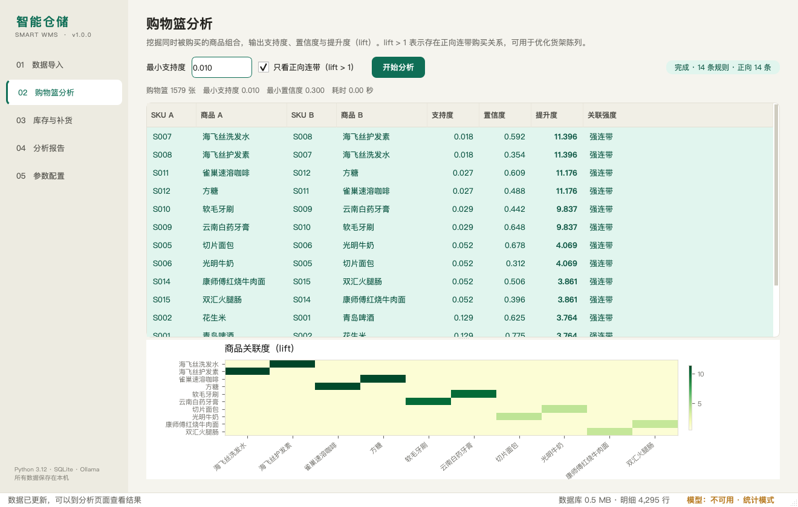

# v1.0.0 — 智能仓储管理系统首个完整版本

> 发布日期：2026-11-03
> 适用平台：Windows 10/11（主要）、macOS / Linux
> 运行环境：Python 3.10+（推荐 3.12）、SQLite、可选 Ollama



## 🎉 这个版本做了什么

从"只有骨架和 38 个 `NotImplementedError`"做到了**可演示、可测试、可交付**的
完整桌面应用：

- 五个页面全部接线：数据导入、购物篮分析、库存与补货、分析报告、参数配置；
- 四个算法模块全部实现：Apriori、补货预测、ABC×XYZ、换季趋势；
- 本地 LLM 六类任务全部实现，带 JSON 校验、重试与降级；
- 53 个自动化测试全绿，三年 77 万行数据压测通过；
- README、需求分析、概要设计、用户手册、测试报告、发布页齐全。

## ✨ 亮点功能

### 1. 购物篮分析（Apriori）

- 手写 Apriori，没有 `mlxtend` 依赖；
- 输出 support / confidence / lift，lift 保留 3 位小数；
- 示例数据中 7 组埋入关系全部挖出，最强规则 lift = **11.396**；
- 附 lift 热力图，直接指导货架陈列。

### 2. 补货预测

```
SS  = z · σ_d · √LT
ROP = d̄ · LT + SS
建议补货日 = 今天 + (库存 − SS)/d̄ − LT
```

- 指数平滑估计日均销量；
- 按服务水平换算 z 值；
- 紧急 SKU 红色高亮，附建议补货量。

### 3. ABC × XYZ 交叉分类

- ABC 看销售额贡献，XYZ 看需求稳定性；
- 结合周转天数判定畅销 / 正常 / 滞销 / 呆滞；
- 比单一销量阈值更能区分"核心畅销"和"高波动长尾"。

### 4. 本地 LLM 工程

| 调用方式 | 耗时 | JSON 合法 |
|---|---:|---|
| 裸调用 | 116.1 s | ❌ |
| `format=json` + `num_predict=300` | **5.1 s** | ✅ |

- 只走 Ollama 原生 `/api/chat`；
- `format=json` + 限长，避免 qwen3 的"思考"拖垮超时；
- JSON 解析失败重试 1 次；
- 服务未启动 / 模型未下载 / 超时 / JSON 非法，四种原因四种提示；
- 模型不可用时报告页显示"基础统计模式"，其余功能不受影响。

### 5. 工程细节

- 数据导入自动识别 UTF-8 / GBK，错误信息带行号；
- 原始文件只读，校验前后 SHA-256 一致；
- 重复导入幂等，不会让三年数据库膨胀；
- `ANALYZE` + 覆盖索引，全量 31.9 万条明细查询 248 ms；
- 分析任务放在 `QThread`，界面不卡死；
- 参数落库、历史报告、数据库备份全部可用。

## ✅ 验证结果

### 自动化测试

```text
53 passed in 0.30s
```

| 文件 | 用例 |
|---|---:|
| `tests/test_algorithms.py` | 16 |
| `tests/test_data_layer.py` | 8 |
| `tests/test_ingest.py` | 11 |
| `tests/test_seasonal.py` | 7 |
| `tests/test_llm.py` | 11 |

### 容量与性能

标准场景：300 SKU / 日均 100 单 / 1,095 天。

| 指标 | 结果 |
|---|---:|
| 总行数 | 772,470 |
| 数据库 | 59.7 MB |
| 批量导入 | 5.6 s |
| 最慢查询 | 248 ms |
| 需求上限 | 15 s / 2 GB |

### 手工验收

12 项全部通过，包括：五个页面可操作、示例数据一键导入、
规则表 + 热力图、补货表标红、分类表、图表、报告降级、参数保存、
历史回看、数据库备份、脏数据拦截、原始文件不被修改。

## 📦 安装

### Windows

```text
1. 安装 Python 3.12（勾选 Add python.exe to PATH）
2. 双击 安装环境.bat
3. 双击 run.bat
4. 在「数据导入」页点击「一键载入示例数据」
```

### macOS / Linux

```bash
git clone https://github.com/SBTstudio/Intelligent_Warehousing.git
cd Intelligent_Warehousing
python3.12 -m venv .venv
source .venv/bin/activate
pip install -r requirements.txt
./run.sh
```

### 本地模型（可选）

```bash
ollama pull qwen3:4b
ollama list
```

不安装 Ollama 也能使用全部统计功能；报告页会自动降级。

## 🔄 升级说明

- 首次启动会自动建表；已有 `data/app.db` 会做兼容性迁移；
- 配置表缺失的键会自动补默认值；
- 无需手动迁移数据。

## ⚠️ 已知限制

- M14 客户画像未实现（需要真实会员 ID 与跨月购买记录）；
- 暂未提供手动逐行录入；
- 暂未打包 exe / dmg；
- 示例数据日销量波动大，XYZ 分类多为 Z，属真实零售数据常见现象；
- 本地 4B 模型输出质量受硬件与模型档位影响，所有数字仍以算法层为准。

## 🙏 致谢

- 课程需求文档与原始规划；
- PySide6 / Qt、SQLite、matplotlib、Ollama、Qwen 开源社区；
- 两位小组成员：算法线与应用线。

## 📚 相关链接

- [README](https://github.com/SBTstudio/Intelligent_Warehousing/blob/main/README.md)
- [CHANGELOG](https://github.com/SBTstudio/Intelligent_Warehousing/blob/main/CHANGELOG.md)
- [需求分析](https://github.com/SBTstudio/Intelligent_Warehousing/blob/main/docs/需求分析.md)
- [概要设计](https://github.com/SBTstudio/Intelligent_Warehousing/blob/main/docs/概要设计.md)
- [用户手册](https://github.com/SBTstudio/Intelligent_Warehousing/blob/main/docs/用户手册.md)
- [测试报告](https://github.com/SBTstudio/Intelligent_Warehousing/blob/main/docs/测试报告.md)

---

**完整变更**：见 [CHANGELOG](https://github.com/SBTstudio/Intelligent_Warehousing/blob/main/CHANGELOG.md)
