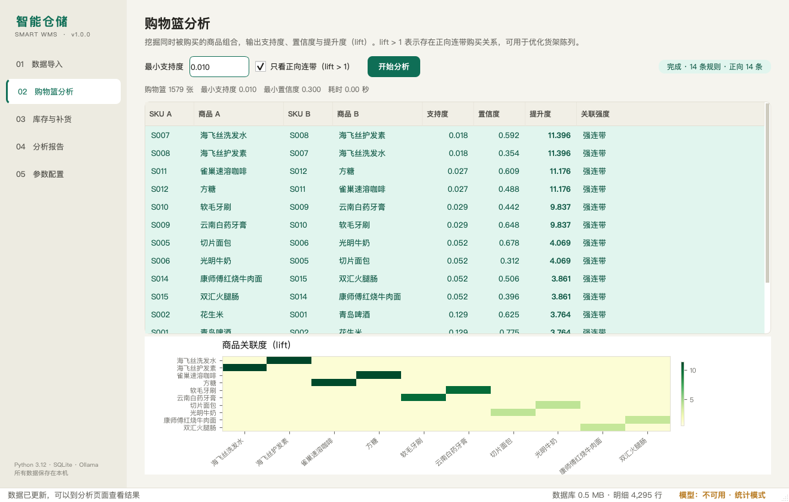

# v1.0.2 — 新增第三方 OpenAI 兼容 API

> 发布日期：2026-11-11
> 默认仍是 Ollama 本地模型；第三方 API 是显式可选，不会自动联网。



## ✨ 本版本重点

「分析报告」不再只能跑本地 Ollama，新增 **第三方 OpenAI 兼容 API** 接入：

- 支持 DeepSeek、通义千问兼容模式、OpenAI、Moonshot 等；
- 在「参数配置 → 模型来源」切换，不需要改代码；
- 可填 Base URL、模型名、API Key、超时；
- 「测试连接」会实际请求 `/models` 并显示可用模型；
- JSON 任务使用 `response_format`，服务商不支持时自动去掉重试；
- `401/403` 鉴权失败、`429` 限流、`404` 模型不存在、超时、连接失败分别提示；
- 第三方 API 不可用时仍自动降级为模板报告，统计/补货/分类不受影响。

## 🔐 隐私边界

- 默认仍是 **Ollama 本地模型**，数据不出本机；
- 只有用户主动切换「第三方 API」后，才会把**聚合摘要**发送到服务商；
- 不会上传原始 CSV、数据库文件或逐笔交易明细；
- API Key 可保存本机 SQLite，也可用环境变量 `SMARTWMS_API_KEY` 覆盖。

## 📦 下载

| 平台 | 文件 | 说明 |
|---|---|---|
| Windows 10/11 x64 | `SmartWMS-Windows-x64.exe` | 免安装单文件，双击运行 |
| macOS Apple Silicon | `SmartWMS-macOS-arm64.dmg` | 打开后拖进 Applications |

安装包内已带示例数据，首次打开点「一键载入示例数据」即可。
Ollama 与第三方 API 都是可选的，不配置任何模型也能使用统计功能。

### Windows

1. 双击 `SmartWMS-Windows-x64.exe`；
2. SmartScreen 提示时选择「更多信息 → 仍要运行」；
3. 数据保存在 `%LOCALAPPDATA%\SmartWMS\app.db`。

### macOS

1. 双击 dmg，把 `SmartWMS` 拖进 `Applications`；
2. 首次打开若提示无法验证开发者，右键 App →「打开」，或执行：

```bash
xattr -dr com.apple.quarantine /Applications/SmartWMS.app
open /Applications/SmartWMS.app
```

3. 数据保存在 `~/Library/Application Support/SmartWMS/app.db`。

## 🔧 配置示例

| 服务商 | Base URL | 模型名 |
|---|---|---|
| DeepSeek | `https://api.deepseek.com/v1` | `deepseek-chat` |
| 通义千问（兼容模式） | `https://dashscope.aliyuncs.com/compatible-mode/v1` | `qwen-plus` |
| OpenAI | `https://api.openai.com/v1` | `gpt-4o-mini` |
| Moonshot | `https://api.moonshot.cn/v1` | `moonshot-v1-8k` |

## ✅ 验证

- `pytest`：**61 passed**（新增 8 个第三方 API 用例）
- GitHub Actions：Python 3.10 / 3.12 测试通过
- 第三方 API 协议、鉴权、限流、404、超时、JSON 回退均有单元测试
- macOS / Windows 安装包由 GitHub Actions 构建并上传

## ⚠️ 已知限制

- 第三方 API 的具体输出质量取决于服务商模型，数字仍以算法层为准；
- 当前适配 OpenAI Chat Completions 协议，不保证所有自定义接口完全兼容；
- Windows exe / macOS dmg 未做商业代码签名，首次打开有系统提示；
- macOS dmg 为 Apple Silicon（arm64）版本。

## 📚 相关链接

- [README](https://github.com/SBTstudio/Intelligent_Warehousing/blob/main/README.md)
- [用户手册](https://github.com/SBTstudio/Intelligent_Warehousing/blob/main/docs/用户手册.md)
- [概要设计](https://github.com/SBTstudio/Intelligent_Warehousing/blob/main/docs/概要设计.md)
- [CHANGELOG](https://github.com/SBTstudio/Intelligent_Warehousing/blob/main/CHANGELOG.md)
