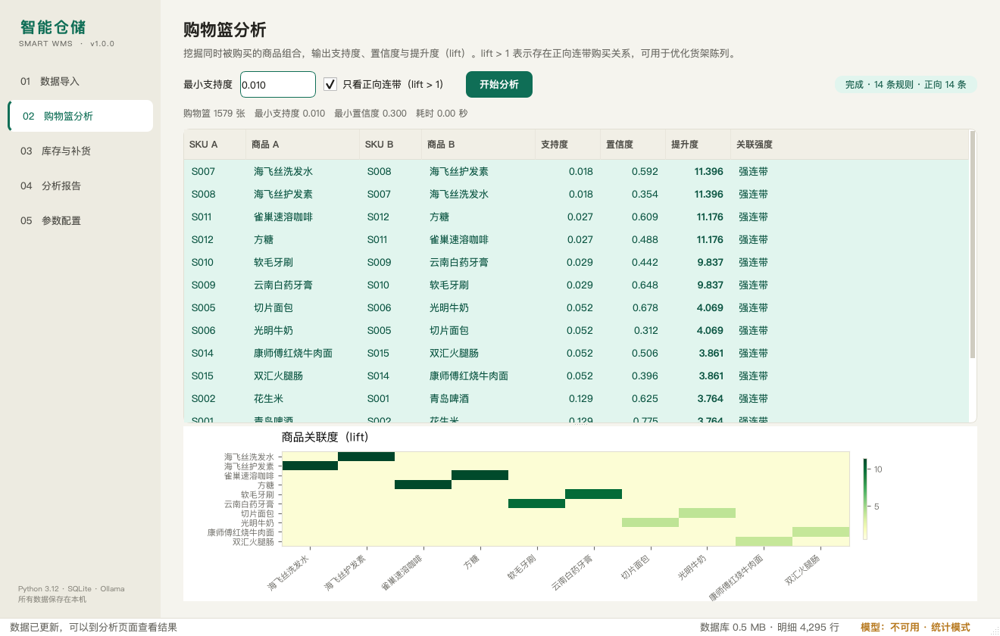

# v1.0.3 — 实时库存 / 收银辅助

> 发布日期：2026-11-13
> 这个版本让软件在营业过程中也能持续使用，而不只是事后分析。



## ✨ 本版本重点

### 1. 实时库存 / 收银辅助

新增「实时库存」页：

- 直接填写 **商品编号、商品名称、品类、进价、售价、当前库存**，保存即建档；
- 「当前库存」表格每行有 **卖出 1 / 补货 1** 按钮：
  - 卖出：库存 -1，同时写销售流水、订单号、秒级时间戳；
  - 补货：库存 +N，同时写补货流水和时间戳；
- 顶部「扫码 / 手输」支持 SKU、商品名、条码，来源可选手动 / 条形码 / NFC；
- 「变动记录」按时间倒序展示：动作、变动量、变动后库存、来源、订单号、备注；
- 卖出会同步写入 `transactions` / `transaction_items`，
  所以购物篮、补货、报告都会使用最新营业数据。

### 2. 中文空白模板

「数据导入」页新增三个下载按钮：

- 下载小票模板 → `订单号,商品编号,商品名称,数量,交易时间,单价`
- 下载库存模板 → `商品编号,商品名称,库存数量,进货成本,快照时间`
- 下载商品档案模板 → `商品编号,商品名称,品类,进货成本,零售价格`

模板带 UTF-8 BOM，Excel 双击打开不乱码；填写后可直接导回软件。

### 3. 条形码 / NFC 预留接口

`app/core/realtime.py` 提供统一扩展点：

```python
from app.core import realtime

def resolve_barcode(code: str) -> str | None:
    return barcode_map.get(code)   # 返回 SKU

realtime.register_code_resolver("barcode", resolve_barcode)
realtime.record_sale_by_code("6901234567890", source="barcode")
```

以后接条码枪、NFC 读卡器或外部中间件时，不需要改库存和 UI 逻辑。

## 🗄 数据与迁移

- 新增 `inventory_events` 表：秒级时间戳、动作、变动量、变动后库存、来源、订单号；
- `products` 增加 `updated_at`；
- 旧数据库第一次启动时自动迁移，不需要手动改表；
- 实时卖出与库存扣减在同一个数据库事务里完成，库存不足会拒绝操作。

## 📦 下载

| 平台 | 文件 | 说明 |
|---|---|---|
| Windows 10/11 x64 | `SmartWMS-Windows-x64.exe` | 免安装单文件，双击运行 |
| macOS Apple Silicon | `SmartWMS-macOS-arm64.dmg` | 打开后拖进 Applications |

安装包内已带示例数据；Ollama / 第三方 API 都是可选项。

### Windows

1. 双击 `SmartWMS-Windows-x64.exe`；
2. SmartScreen 提示时选择「更多信息 → 仍要运行」；
3. 数据保存在 `%LOCALAPPDATA%\SmartWMS\app.db`。

### macOS

1. 双击 dmg，把 `SmartWMS` 拖进 `Applications`；
2. 首次打开若提示无法验证开发者，右键 App →「打开」，或执行：

```bash
xattr -dr com.apple.quarantine /Applications/SmartWMS.app
open /Applications/SmartWMS.app
```

3. 数据保存在 `~/Library/Application Support/SmartWMS/app.db`。

## ✅ 验证

- `pytest`：**69 passed**
- 新增 7 个实时库存测试 + 1 个中文模板测试
- GitHub Actions：Python 3.10 / 3.12 均通过
- Windows / macOS 安装包由 Actions 构建并上传

## ⚠️ 已知限制

- 扫码/NFC 目前是接口预留，需要接入硬件解析器；
- 卖出/补货按钮固定操作 1 件，批量操作可在顶部设置数量；
- Windows exe / macOS dmg 未做商业代码签名，首次打开有系统提示；
- macOS dmg 为 Apple Silicon（arm64）版本。

## 📚 相关链接

- [README](https://github.com/SBTstudio/Intelligent_Warehousing/blob/main/README.md)
- [用户手册](https://github.com/SBTstudio/Intelligent_Warehousing/blob/main/docs/用户手册.md)
- [概要设计](https://github.com/SBTstudio/Intelligent_Warehousing/blob/main/docs/概要设计.md)
- [CHANGELOG](https://github.com/SBTstudio/Intelligent_Warehousing/blob/main/CHANGELOG.md)
