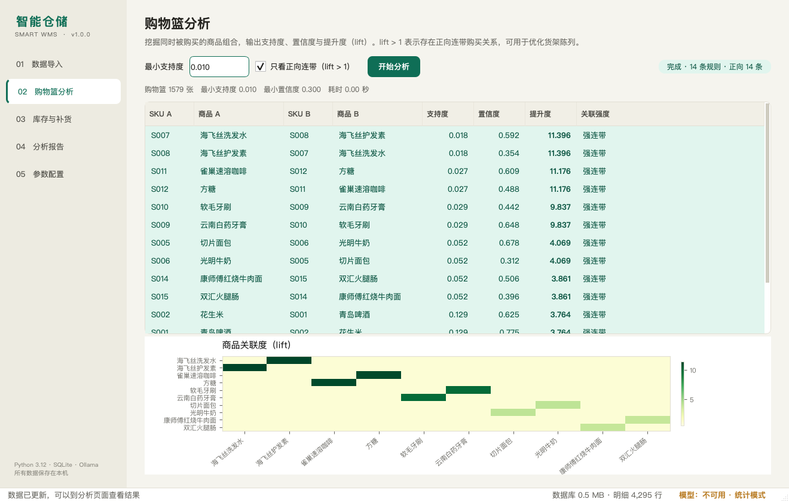

# v1.0.4 — 收银台 + 首页

> 发布日期：2026-11-17
> 这个版本让软件真正可以放在收银台旁边使用：多件商品先加入同一张小票，最后结账。



## ✨ 本版本重点

### 1. 收银台：一张小票多次扫码

- 顶部输入 SKU、商品名或条码，按回车加入当前小票；
- 同一张小票可以连续加多种商品，同一 SKU 自动合并数量；
- 点「结账」生成 **一个 order_id + 多条商品明细** 的完整订单；
- 库存不足时整单拒绝，不会产生半张订单；
- 结账成功后，库存、销售流水、分析数据自动刷新。

### 2. 首页入口 + 精简版指南

- 启动默认进入首页；
- 显示商品数、库存总量、累计订单、库存变动；
- 一键进入收银台、实时库存、数据导入；
- 「查看精简版使用指南」弹窗，1 分钟看完操作流程。

### 3. 输入体验与日期修正

- 「实时库存」进价、售价、库存输入框改为空白占位提示（不是写死的 0.00），直接输入；
- 补货建议日以打开软件当天为基准，不按小票日期；
- 已经算到过去的补货日会落到今天，并标记「需补货（已逾期）」。

## 📦 下载

| 平台 | 文件 | 说明 |
|---|---|---|
| Windows 10/11 x64 | `SmartWMS-Windows-x64.exe` | 免安装单文件 |
| macOS Apple Silicon | `SmartWMS-macOS-arm64.dmg` | 打开后拖进 Applications |

安装包内已带示例数据；Ollama / 第三方 API 都可选。

### Windows

1. 双击 `SmartWMS-Windows-x64.exe`；
2. SmartScreen 提示时选择「更多信息 → 仍要运行」；
3. 数据保存在 `%LOCALAPPDATA%\SmartWMS\app.db`。

### macOS

1. 双击 dmg，把 `SmartWMS` 拖进 `Applications`；
2. 首次打开若提示无法验证开发者，右键 App →「打开」，或执行：

```bash
xattr -dr com.apple.quarantine /Applications/SmartWMS.app
open /Applications/SmartWMS.app
```

3. 数据保存在 `~/Library/Application Support/SmartWMS/app.db`。

## ✅ 验证

- `pytest`：**73 passed**
- 新增收银台多商品结账、整单库存不足原子性、补货日期基准测试
- GitHub Actions：Python 3.10 / 3.12 均通过
- Windows / macOS 安装包由 Actions 构建并上传

## ⚠️ 已知限制

- 收银台当前不支持行内临时改价，需要先改商品档案售价；
- 条形码/NFC 仍是接口预留，需要接入硬件解析器；
- 安装包未做商业代码签名，首次打开有系统提示；
- macOS dmg 为 Apple Silicon（arm64）版本。

## 📚 相关链接

- [README](https://github.com/SBTstudio/Intelligent_Warehousing/blob/main/README.md)
- [用户手册](https://github.com/SBTstudio/Intelligent_Warehousing/blob/main/docs/用户手册.md)
- [概要设计](https://github.com/SBTstudio/Intelligent_Warehousing/blob/main/docs/概要设计.md)
- [CHANGELOG](https://github.com/SBTstudio/Intelligent_Warehousing/blob/main/CHANGELOG.md)
