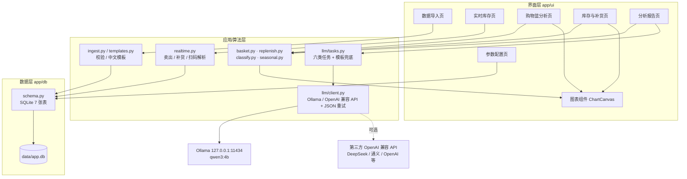
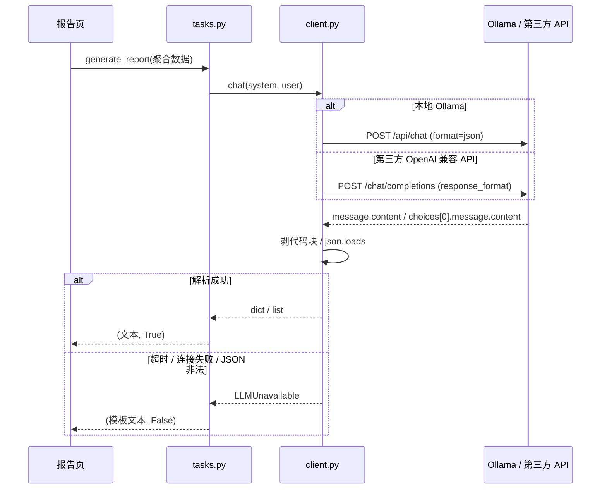

# 概要设计

> 项目：智能仓储管理系统（Smart WMS）v1.0.3
> 技术栈：Python 3.12 · PySide6 · SQLite · matplotlib · Ollama / OpenAI 兼容 API
> 对应需求：[需求分析](./需求分析.md)

---

## 一、总体架构

系统是单机桌面应用，按"界面 → 服务/算法 → 数据"三层组织。
`app/core/` 与 `app/llm/` 不依赖 PySide6，可以脱离界面单独测试。



### 分层职责

| 层 | 目录 | 职责 | 约束 |
|---|---|---|---|
| 界面层 | `app/ui/` | 布局、交互、表格、图表、状态提示 | 不写业务公式 |
| 算法层 | `app/core/` | 统计、Apriori、补货、分类、季节 | **禁止 import PySide6** |
| LLM 层 | `app/llm/` | Prompt、HTTP、JSON 校验、降级 | 只接收聚合摘要 |
| 数据层 | `app/db/` | 建表、读写、配置、备份 | 单文件 SQLite |

---

## 二、数据设计

### 2.1 表结构

```sql
products(sku_id PK, sku_name, category, cost, price, updated_at)
transactions(order_id PK, ts, total_amount)
transaction_items(id PK, order_id, sku_id, qty, unit_price)
inventory(sku_id, snapshot_date, stock_qty, cost, PK(sku_id, snapshot_date))
inventory_events(id PK, sku_id, ts, action, delta, stock_after,
                 unit_price, cost, source, order_id, note)
reports(report_id PK, report_type, generated_at, sample_size, content, params)
config(key PK, value)
```

### 2.2 关键设计

1. **交易拆头/明细**：购物篮分析需要按 `order_id` 聚合，头表存时间与总额，
   明细表存 SKU 与数量。
2. **幂等导入**：`transaction_items` 上 `(order_id, sku_id)` 唯一索引，
   `INSERT OR REPLACE` 保证重复导入不膨胀。三年数据重复导入是致命问题，
   必须从数据库约束层解决。
3. **ISO 时间文本**：SQLite 无原生日期类型，`YYYY-MM-DD HH:MM` 可直接
   字符串比较，配合 `idx_tx_ts` 做时间窗口筛选。
4. **覆盖索引**：`idx_inv_sku_stock(sku_id, stock_qty)` 避免库存聚合回表。
5. **ANALYZE**：大数据量下 SQLite 没有统计信息会选错执行计划；
   单批导入 ≥2000 行时自动 `ANALYZE`。

### 2.3 索引清单

| 索引 | 表 | 用途 |
|---|---|---|
| `idx_tx_ts` | transactions | 时间窗口筛选 |
| `idx_item_order` | transaction_items | 按订单聚合购物篮 |
| `idx_item_sku` | transaction_items | 按 SKU 汇总 |
| `uq_item_order_sku` | transaction_items | 幂等唯一约束 |
| `idx_inv_sku_stock` | inventory | 库存覆盖索引 |

---

## 三、算法设计

### 3.1 Apriori 购物篮分析

```
support(A→B)    = |A∩B| / N
confidence(A→B) = support(A∪B) / support(A)
lift(A→B)       = confidence(A→B) / support(B)
                = P(A∩B) / (P(A)·P(B))
```

实现要点：

- 按 `order_id` 聚合成 `set`，同一张小票重复 SKU 只算一次；
- L1 统计单品支持度，低于阈值剪枝；
- 由 Lk 两两合并生成候选 C(k+1)，检查所有 k 子集是否频繁（Apriori 剪枝）；
- **计数方式**：枚举每个购物篮内的 k 元子集，只统计候选集合中的组合，
  复杂度从 `O(候选数 × 篮子数)` 降到 `O(篮子内组合数)`；
- 对频繁项集枚举非空真子集生成规则，按 lift 降序；
- `lif_matrix()` 取 top-N 商品生成热力图矩阵。

性能：示例数据 1,579 张购物篮 0.00 s；三年 124,476 张购物篮仍在秒级。

### 3.2 补货预测

```
d̄    = 指数平滑(日销量, α=0.3)
σ_d  = 日销量总体标准差
z    = 服务水平对应的正态分位（95% → 1.65）
SS   = z · σ_d · √LT
ROP  = d̄ · LT + SS
剩余天数 = (库存 − SS) / d̄
建议补货日 = 今天 + 剩余天数 − LT
建议补货量 = d̄ · (LT + 补货周期) + SS − 库存
```

边界处理：

- `d̄ = 0`：不补货（转滞销处理），避免除零；
- 有效销售天数 < 7：在 `note` 里提示补充数据；
- `lead_time = 0`：安全库存为 0，仍按 ROP 判断；
- 所有系数保留 3 位小数输出。

### 3.3 ABC × XYZ 分类

- **ABC**：按销售额降序累计，≤70% A，≤90% B，其余 C；零销售额直接 C。
- **XYZ**：`CV = σ/μ`，<0.2 X，<0.5 Y，≥0.5 Z；μ=0 判 Z。
- **判定顺序**：
  1. C 类且周转 > 2×阈值 → 呆滞；
  2. C 类且 Z 类且周转 > 阈值 → 滞销；
  3. A 类 → 畅销；
  4. 其余 → 正常。

### 3.4 换季趋势

```
YoY = (本月 − 去年同月) / 去年同月
MoM = (本月 − 上月) / 上月
季节指数 = 该月平均销量 / 全年月均销量
```

- 去年同月缺失时返回 `None`，不拿 0 当分母；
- 趋势斜率用最小二乘手算，不依赖 numpy；
- 换季评分：45% 下月季节指数 + 25% 环比 + 20% 同比 + 10% 趋势斜率；
- 输出可解释的 `reason` 与 `action`。

---

## 四、LLM 接入设计

### 4.1 调用链



### 4.2 关键工程点

1. **默认本地**：Ollama 走原生 `/api/chat`，只有原生接口支持 `format` 与
   `options.num_predict`；默认不连接外网。
2. **`format=json` + `num_predict=400`**：实测从 116 s / 非法 JSON
   降到 5.1 s / 合法 JSON。qwen3 默认思考模式会生成大量 token，
   不限制输出长度会拖垮超时。
3. **第三方 API**：适配 OpenAI Chat Completions 协议；
   JSON 任务发送 `response_format={"type":"json_object"}`，
   服务商不支持时自动去掉该字段重试一次；按 `401/403/404/429/超时` 分类提示。
4. **JSON 容错**：剥 ` ```json ` 包裹；整段解析失败后按括号配对截取；
   失败重试 1 次；仍失败抛 `LLMUnavailable`。
5. **分层降级**：
   - 连接失败 → 立即降级（重试无意义）；
   - 超时 → 降级；
   - JSON 非法 → 重试后降级；
   - 本地模型缺失 → 提示 `ollama pull`；
   - 第三方鉴权/限流/模型不存在 → 分别提示。
6. **数字边界**：Prompt 明确"不要自行计算或修改任何数字"，
   所有统计值由算法层传入；第三方只收到聚合摘要。

### 4.3 六类任务

| 函数 | 输入 | 输出 | 降级 |
|---|---|---|---|
| `generate_report` | 补货表 + 分类 + 规则 | 经营周报 | 模板报告 + 降级说明 |
| `analyze_slow_movers` | 滞销/呆滞 SKU | 原因/动作/备注 | 空列表 + False |
| `suggest_layout` | lift>1 规则 | 陈列建议 | 规则版建议 |
| `recommend_seasonal` | 月度记录 | 换季建议 | 规则版建议 |
| `map_trend_to_sku` | 热点文本 | 品类映射 | 关键词匹配 |
| `explain_anomaly` | 统计 dict | 异常解释 | 客观描述 |

---

## 五、界面设计

| 页面 | 主要控件 | 关键交互 |
|---|---|---|
| 数据导入 | 文件选择、错误列表、预览表 | 校验通过才允许导入；一键载入示例数据 |
| 购物篮分析 | 支持度、正向过滤、规则表、热力图 | 后台线程计算，完成后填表/画图 |
| 库存与补货 | 补货表、分类表、图表页 | 紧急行标红；ABC/XYZ 配色；SKU 折线切换 |
| 实时库存 | 商品表单、库存表、卖出/补货按钮、变动记录 | 建档、卖出、补货、扫码/NFC 入口；每次变动写时间戳 |
| 分析报告 | 类型下拉、报告正文、历史下拉 | 五类报告；模型不可用显示横幅；保存/回看 |
| 参数配置 | 业务参数、模型来源、API 配置、备份 | 落库、测试连接、广播刷新、数据库统计 |

### 线程模型

耗时操作（Apriori、全量分类、LLM 调用）通过 `FunctionWorker(QThread)` 执行，
结果通过 Qt Signal 回到主线程。页面持有 worker 引用，避免 QThread 被 GC。
界面在任务期间禁用按钮并显示状态胶囊。

### 状态提示

- 绿色：完成 / 正常 / 模型在线；
- 蓝色：进行中 / 已复制 / 历史载入；
- 琥珀：降级 / 数据不足 / 参数变更；
- 红色：校验失败 / 计算失败 / 紧急补货。

---

## 六、异常与降级矩阵

| 场景 | 系统行为 |
|---|---|
| 数据库不存在 | 启动时自动建表 |
| 导入空文件 | 拒绝并提示"只有表头/没有数据行" |
| 编码无法识别 | 列出尝试过的编码，不崩溃 |
| 缺少必需列 | 列出缺失列名 |
| 非法行 | 显示行号与前 40 条错误，禁止导入 |
| Ollama 未启动 | 报告页基础统计模式，其余功能正常 |
| 本地模型缺失 | 提示模型名与 `ollama pull` 命令 |
| 第三方 API 未配置 Key | 提示到参数配置填写，或使用 `SMARTWMS_API_KEY` |
| 第三方 API 401/403 | 提示鉴权失败，检查 Key / 模型权限 |
| 第三方 API 429 | 提示限流，检查配额 / 稍后重试 |
| 第三方 API 404 | 提示 Base URL 或模型名不存在 |
| LLM 超时 | 本地 60 s / 第三方可配置，超时降级 |
| LLM JSON 非法 | 重试 1 次后降级 |
| 热点为空 | 提示先粘贴文本 |
| 数据为空 | 各页面给出"请先导入数据"引导 |

### 6.1 实时库存与收银辅助

```text
实时库存页
  ├─ 商品表单：SKU / 名称 / 品类 / 进价 / 售价 / 库存
  ├─ 库存表：每行「卖出 1」「补货 1」
  ├─ 扫码/手输：SKU / 商品名 / 条码，来源 manual / barcode / nfc
  └─ 变动记录：时间戳 / 动作 / 变动量 / 变动后库存 / 订单号
        │
        ▼
realtime.py
  ├─ save_product()      建档 / 编辑 / 调整库存
  ├─ record_sale()       扣库存 + transactions + transaction_items + event
  ├─ record_restock()    加库存 + event
  ├─ record_sale_by_code()  扫码卖出
  └─ register_code_resolver()  条码/NFC 扩展点
        │
        ▼
inventory_events（秒级时间戳，永久留痕）
```

关键约束：

- 卖出必须在一个数据库事务里同时完成"扣库存 + 写销售流水 + 写事件"，避免账实不一致；
- 库存不足时抛 `InsufficientStock`，不产生销售流水；
- 每次变动更新 `products.updated_at`，并写 `inventory.snapshot_date` 为秒级时间戳；
- 条码/NFC 通过 resolver 注册，不侵入 UI 和核心逻辑；
- 中文空白模板由 `templates.py` 生成，UTF-8 BOM + 中文表头。

---

## 七、性能与容量

- 标准场景：300 SKU / 日均 100 单 / 1095 天 → 77.2 万行 / 59.7 MB；
- 最慢查询：全量 31.9 万条明细 248 ms；
- 三年数据完整分析远低于 15 s；
- 明细表幂等，重复导入不膨胀；
- 大表查询走覆盖索引，避免回表。

详见 [数据存储设计说明](./数据存储设计说明.md)。

---

## 八、安全与隐私

- 所有数据默认保存在本机 `data/app.db`；
- 默认 LLM 只访问 `127.0.0.1:11434`；第三方 API 需用户在参数配置里显式开启；
- 第三方 API 只接收聚合摘要，不上传原始 CSV / 数据库 / 逐笔明细；
- 导入文件只读，不修改原始业务文件；
- 备份文件由用户选择路径；
- 无账号体系（单机单用户场景）。

---

## 九、部署

- Windows：`安装环境.bat` → `run.bat`；
- macOS / Linux：`python -m venv .venv` → `pip install -r requirements.txt` → `./run.sh`；
- 可选安装 Ollama 并 `ollama pull qwen3:4b`；
- 数据目录可整体拷贝迁移；`VACUUM INTO` 生成单文件备份。
